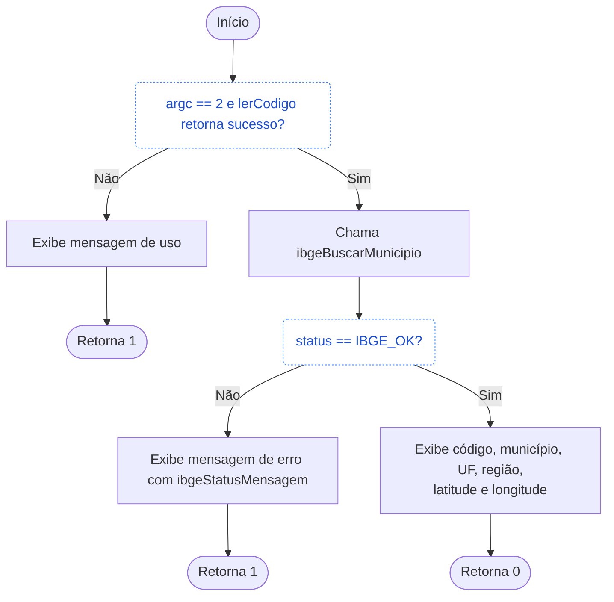
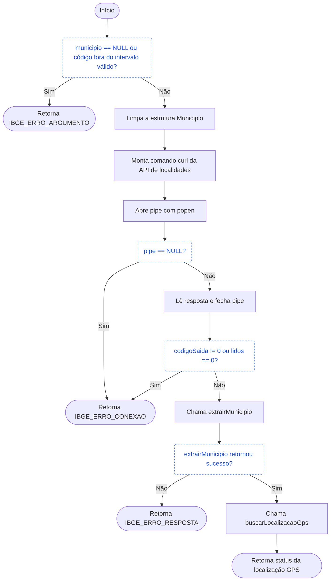
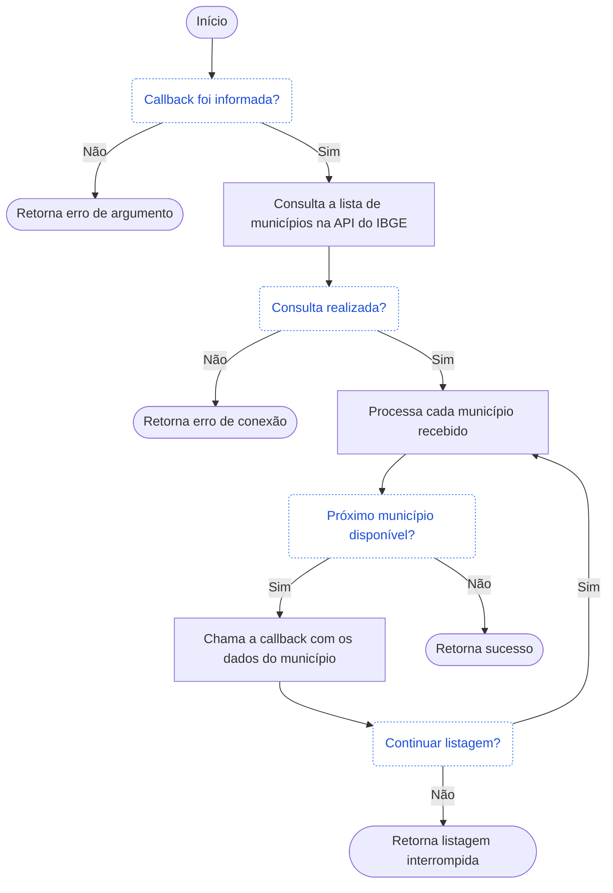
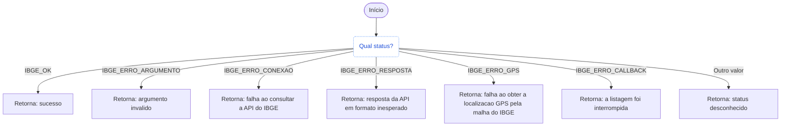

# Como visualizar os fluxogramas

Este arquivo utiliza blocos de código `mermaid` para representar os fluxogramas.

No VS Code, abra este arquivo e pressione `Ctrl+Shift+V` para abrir a visualização do Markdown. Também é possível usar o comando **Markdown: Open Preview** na paleta de comandos (`Ctrl+Shift+P`). Os fluxogramas serão renderizados nessa visualização.

No site do GitHub, a visualização dos blocos Mermaid é automática: basta abrir ou acessar o arquivo `fluxograma.md` no repositório para ver os fluxogramas renderizados.

# Fluxogramas das funções não `static`

Este arquivo apresenta, em Mermaid, o fluxo das funções não `static` do projeto `atividade03`:

- `main`
- `ibgeBuscarMunicipio`
- `ibgeListarMunicipios`
- `ibgeStatusMensagem`

## `main`

Legenda:

- **Argumentos válidos?**: verifica se foi informado exatamente um argumento e se `lerCodigo` conseguiu convertê-lo em um código válido.
- **Status == IBGE_OK?**: verifica se a consulta ao município foi concluída com sucesso.

## `ibgeBuscarMunicipio`

Legenda:

- **municipio == NULL ou código fora do intervalo válido?**: verifica se os argumentos são inválidos.
- **pipe == NULL?**: verifica se não foi possível iniciar o comando `curl`.
- **codigoSaida != 0 ou lidos == 0?**: verifica se o `curl` falhou ou retornou uma resposta vazia.
- **extrairMunicipio retornou sucesso?**: verifica se a resposta contém os dados do município em formato reconhecido.

## `ibgeListarMunicipios`

Legenda:

- **Callback foi informada?**: verifica se há uma função para receber os municípios listados.
- **Consulta realizada?**: verifica se foi possível obter a lista na API.
- **Próximo município disponível?**: verifica se ainda há municípios para processar.
- **Continuar listagem?**: a callback determina se a listagem continua ou é interrompida.

## `ibgeStatusMensagem`

Legenda:

- **Qual status?**: seleciona a mensagem correspondente ao valor recebido em `status`; valores não reconhecidos produzem a mensagem de status desconhecido.
